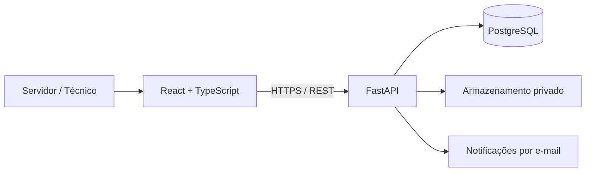

# Central de TI — PMMP

Aplicação web para abertura, acompanhamento e gestão de chamados de Tecnologia da Informação, concebida para a realidade da Prefeitura de Miguel Pereira.

> **Status:** protótipo navegável publicado e fundação do MVP real em desenvolvimento. O projeto ainda não está homologado para uso institucional e não deve receber dados pessoais, credenciais ou documentos reais.

## Demonstração

**Preview privado:** https://central-ti-pmmp-demo.cnogfogo20.chatgpt.site

A demonstração permite entrar como servidor ou técnico, abrir chamados, receber protocolo, trocar mensagens, atribuir responsável, alterar status e registrar a resolução. Os dados são fictícios e ficam somente no `localStorage` do navegador.

## Problema que o projeto resolve

Pedidos de suporte enviados por telefone ou mensagens particulares são difíceis de priorizar, acompanhar e auditar. A Central de TI organiza esse fluxo em um canal simples para o servidor e em uma fila operacional para a equipe técnica.

## Funcionalidades

### Portal do servidor

- acesso demonstrativo por perfil;
- categorias claras e linguagem não técnica;
- abertura de chamado em poucos passos;
- setor, descrição e anexo simulado;
- protocolo automático;
- histórico e mensagens do atendimento;
- interface mobile-first.

### Painel técnico

- dashboard com indicadores operacionais;
- fila com busca e filtro por status;
- atribuição de responsável;
- estados: Aberto, Em atendimento, Aguardando usuário, Resolvido e Fechado;
- mensagens públicas e notas internas;
- registro obrigatório da solução.

## Arquitetura-alvo



O protótipo publicado utiliza React, TypeScript e Tailwind. A pasta `backend/` inicia a API real em FastAPI/PostgreSQL. A integração entre as duas camadas será feita no próximo marco.

## Executar o protótipo

Requisitos: Node.js 22+ e pnpm.

```bash
pnpm install
pnpm dev
```

## Executar a fundação da API

Requisitos: Docker e Docker Compose.

```bash
copy .env.example .env
docker compose up --build
```

A documentação interativa ficará em `http://localhost:8000/docs` e o health check em `http://localhost:8000/health`.

## Estrutura

```text
app/                 interface React/TypeScript
backend/             API FastAPI e modelos de domínio
docs/                documentação de produto e engenharia
docker-compose.yml   PostgreSQL + API para desenvolvimento
```

## Segurança e uso institucional

Antes de qualquer piloto com dados reais serão obrigatórios: autenticação corporativa, autorização por perfil e recurso, HTTPS, armazenamento privado de anexos, auditoria, política de retenção, backups testados, monitoramento e homologação das áreas responsáveis por TI, segurança, jurídico e proteção de dados.

Consulte [Segurança](docs/SECURITY.md) e [Arquitetura](docs/ARCHITECTURE.md).

## Roadmap

- [x] pesquisa e requisitos do MVP;
- [x] protótipo responsivo com fluxo completo;
- [x] publicação de demonstração;
- [x] fundação da API e ambiente PostgreSQL;
- [ ] autenticação e autorização reais;
- [ ] integração do front-end com a API;
- [ ] anexos privados e notificações;
- [ ] testes automatizados e acessibilidade;
- [ ] piloto controlado e observabilidade.

Veja o [roadmap detalhado](docs/ROADMAP.md).

## Autoria

Projeto idealizado e desenvolvido por **Caio Gonzalez**, com apoio de IA no planejamento, prototipação e documentação.

Este é um projeto independente de estudo e desenvolvimento. Não representa um sistema oficial da Prefeitura de Miguel Pereira enquanto não houver autorização e homologação formais.
