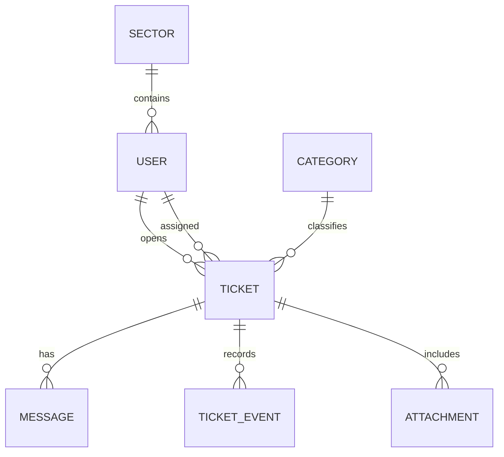

# Arquitetura do sistema

## Visão geral

A solução seguirá um monólito modular: uma API única, organizada por domínios, e uma aplicação web responsiva separada. Essa abordagem reduz custo operacional no início e mantém espaço para evolução.

## Componentes

| Componente | Tecnologia                              | Responsabilidade                          |
| ---------- | --------------------------------------- | ----------------------------------------- |
| Interface  | React, TypeScript, Tailwind             | Portal do servidor e painel técnico       |
| API        | FastAPI, Pydantic, SQLAlchemy           | regras, autorização e auditoria           |
| Banco      | PostgreSQL                              | usuários, chamados, mensagens e histórico |
| Anexos     | armazenamento privado compatível com S3 | arquivos protegidos por autorização       |
| Proxy      | Caddy ou Nginx                          | HTTPS, limites e encaminhamento           |
| Deploy     | Docker Compose inicialmente             | ambientes reproduzíveis                   |

## Módulos de domínio

- Identidade e acesso
- Estrutura organizacional
- Chamados
- Mensagens e anexos
- Atribuições
- Histórico e auditoria
- Notificações
- Relatórios

## Entidades principais

## Decisões

1. O servidor nunca escolhe a prioridade diretamente; informa o impacto.
2. Notas internas são protegidas na API, não apenas escondidas na interface.
3. Chamados não são excluídos no fluxo normal; cancelamentos preservam histórico.
4. A resolução exige um resumo do serviço.
5. O front-end não é fonte de autorização.

## Ambientes

- `demo`: dados fictícios no navegador;
- `development`: API e PostgreSQL locais;
- `staging`: infraestrutura semelhante à produção, sem dados reais;
- `production`: ambiente homologado, monitorado e com backup.
